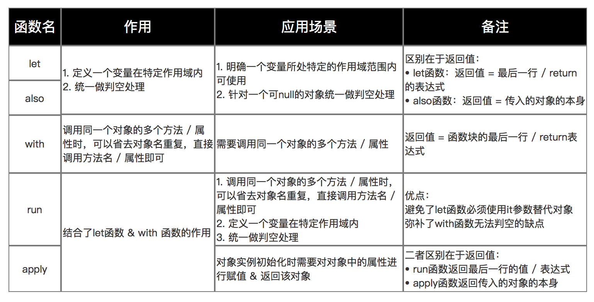

# Kotlin 基础

## 变量

**变量声明**

- `val`，赋值后不可改变变量的值，和Java中的final修饰的变量相似
- `var`，赋值后可以改变值

```kotlin
val count: Int = 10
count = 11 // 编译报错

var sum: Int = 20
sum = count + sum // sum的值变为30
```

- `const`，声明常量

`const` 关键字用于修饰 val 类型的变量，表明该 **变量** 是一个常量。只能修饰顶层属性和类属性，且值必须在编译期就确定，类型只能是 String 和基本类型。

总结：

- `val` 和`var` 可以修饰顶层属性、类属性、局部变量
- `val` 修饰类属性，可以生成 `getter` 方法，`var` 修饰类属性可以生成 `getter` 和`setter` 方法。
- 局部变量不会有 `getter` 和 `setter`，`val` 修饰局部变量相当于 Java 中的 final
- `const` 只能修饰顶层属性和类属性，**值必须在编译期确定**，值的类型只能是 String 和final 类型。编译之后，`const` 修饰的变量都被内联替换了。

**类型推断**

声明变量时同时赋值，即使不显式声明变量的类型，编译器也可以推断出变量的类型。

```kotlin
val count = 10  // Int
val name = 'Tom' // String 

name.inc() // 编译报错，String没有inc()方法
```

**空安全**

Kotlin中，默认类型是非空的，给非空类型变量赋值会编译错误。如果期望变量时可空的，需要在类型后加上`?`

```
val name: String = null // 编译报错

val name: String? = null
```

## 常见操作符

与Java中不一样的操作符

- `?` 表明类型是可空的，如 `val name: String? = null`
- `?:` Elvis操作符，表明左值为空时，取右值，如 `val firstName = name?:'unknown'`，firstName的值是unknown
- `?.` 安全调用，左值为空时，值也返回空，如 `val length = name?.length`，length的值也为null
- `!!` 断言一个表达式非空，如果为空会抛异常
- `==` 与 `!=` 值相等比较，等同于Java中的equals，但是 == 是线程安全的，null == "abc" 不会报错
- `===` 与 `!==` 引用比较，比较的是内存地址，等同于Java中的==
- `$` 字符串模板中引用变量或表达式
- `_` 在lambda或解构中代替未使用的参数

**类型判断**

`is` 和 `!is` 可以用来做类型判断，相当于 Java 中的 instanceof，用 is 判断了类型之后，在代码块中可以自动调用对应类型的方法，例如：

```kotlin
if (obj is String) {
    print(obj.length)
}

if (obj !is String) { // 与 !(obj is String) 相同
    print("Not a String")
} else {
    print(obj.length) // 智能转换
}
```

**类型转换**

`as` 可以用来做类型转换，相当于 Java 中的强制类型转换。不安全的转换会在编译期报错。

```kotlin
val x: String = y as String
```

`as?` 可以做安全的类型转换，当转换失败是返回 null 。

```kotlin
val x: String? = y as? String
```


## 数据类型

### 基本的数据类型

Kotlin 不像 Java 一样，没有原始类型（primitive types），一切都是对象。但是编译器会优化编译产物，根据可空或者非空，编译成原始类型或者包装类型：

- 可空类型被编译成包装类型，例如 `Int? --> Integer`
- 非空类型被编译成原始类型，例如 `Int --> int`

### Unit、Any、Nothing

- `Any` 所有非空类型的父类，类似于 Java 中的 Object;
- `Nothing` 表示“永远不会返回，或者不存在的值”，不能被实例化，通常把一个函数的返回值设置为 Nothing 表明这个函数不会返回会抛异常。由于 Nothing 可以赋值给任意类型，也可以将它看做是任意类型的子类型。
- `Unit` 表示“无意义的返回值”，但是Unit有一个实例

```
         Any          ← 所有非空类型的根类型
        / | \
     Int  String  ...
       \  |  /
       Nothing        ← 所有类型的子类型（底类型）

         Any?         ← 所有类型的根类型（包括可空）
        / | \
     Int? String? ...
       \  |  /
       Nothing?       ← 唯一的值是 null
```

```kotlin
// 抛一个异常
fun fail(message: String): Nothing {
    throw IllegalArgumentException(message)
}

val name: String = user.name ?: fail() // 赋值给String类型的变量
val age: String = if user.age > 0 user.age else fail() // 赋值给Int类型的变量
```

## 条件语句

**if-else**

常规用法和 Java 一样，但是可以 Kotlin 中的 if-else 可以用来当条件表达式，例如：

```kotlin
val String message = if (code == 400) {
  "client error"
} else if (code == 500) {
  "server error"
} else {
  "known error
}
```

Kotlin 中没有 Java 中的三目运算符 ?:，类似的用法都可以用三元表达式来实现。

**when**

当条件较多时，也可以用 `when` 关键字来做条件判断，示例：

```kotlin
var message: String

when {
  code == 400 -> "client error"
  code == 500 -> "server errro"
  else -> "known error"
}
```

`when` 可以带参数也可以不带参数，带参数时，when 的每个条件的返回值都是参数的类型，例如：

```kotlin
var message: String

when (code) {
  200 -> "ok"
  400 -> "client error"
  500 -> "server errro"
  else -> "known error"
}
```

## 函数

简单的函数声明可以省略 {}，例如：

```kotlin
fun sum(n : Int, m : Int) = n + m // 省略了花括号和返回值，因为可以根据类型推断出返回类型
```

### 匿名函数

匿名函数没有函数名，可以将其赋值给变量，变量的类型为 `(参数类型, 参数类型) -> 返回值类型`，调用的时候加上括号，例如：

```java 
// 声明匿名函数
val multi: (Double, Double) -> Double = { x, y ->
    x + y
}

// 使用匿名函数
multi(2.0, 3.0)
val mm = multi
mm(2.0, 3.0)
```

### 高阶函数

高阶函数指的是函数的参数也是函数，例如：

```java
fun advancedFunc(m: Int, mapper: (Int) -> String) : String{
    return mapper(m)
}

advancedFunc(10, { num -> "$num"})
```

高阶函数的最后一个参数如果是匿名函数，在调用时可以把这个匿名函数放在圆括号外面，gradle 的 kotlin DSL 中有很多这种用法。例如上面的调用可以写成：

```
advancedFunc(10) { num ->
  "$num"
}
```

高阶函数会有一些运行时上的开销，因为函数是一个对象，在函数的实现中，会访问局部变量，因此在内存占用和虚拟调用都会有一定的开销。

### 内联函数

内联函数通过 inline 关键字修饰，会将调用函数的地方内联成函数的实现。内联函数会引入额外的代码，不过使用得当也能提升性能。

```kotlin
inline fun inlineFun(m: Int, mapper: (Int) -> String) : String {
    return mapper.invoke(m)
}
```

如果不希望传给函数的参数被内联，也可以用noinline参数修饰函数参数。noinline关键字不能修饰函数，可以修饰函数参数。

```kotlin
inline fun inlineParams(m: Int, mapper: (Int) -> String, noinline reducer: (Int) -> Int): String {
    return mapper.invoke(reducer.invoke(m))
}
```

### Kotlin内置的函数

**let**

let是一个作用域函数，在一个作用域内，对对象统一进行操作而不用重复判空。返回值由作用域内最后一行表达式或者return语句决定。

```kotlin
val american: American? = if (System.nanoTime() % 10 > 5) American() else null
val nation = american?.let {
  it.sayHello()
  it.showGift()
  // 返回值
  it.nation // 也可以写成 return it.nation
}
print(nation)
```

**also**

also的作用和let一样，区别是also返回的是传入作用域的对象。

```kotlin
// also
val chinese = Chinese()
val person = chinese.also {
  it.sayHello()
  // 返回person本身，而不是nation
  it.nation
}
print(person.nation)
```

**with**

with的使用方法和let类似，返回值是最行一行表达式或者return语句。它有2个参数，第二个参数是匿名函数。使用时用`with(obj){...}`
在作用域内使用时可以省略对象名，直接调用对象的方法或属性。

```kotlin
val age = with(chinese) {
  sayHello()
  print("I come from $nation")
  showGift()
  val age = 20
  // 返回age
  age
}
println("with: age $age")

```

**run**

run相当于是let和with的结合体，返回值也是**最后一行表达式**或**return语句**，使用时直接用`obj.run{...}`，作用域内可以省略对象名，直接调用方法或属性

```kotlin
val ret = chinese.run {
    sayHello()
    showGift()
    // 返回bye
    "bye"
}
println("run: $ret")
```

**apply**

apply相当于是also和with的结合体，返回值是**对象本身**。使用时直接用`obj.run{...}`，作用域内可以省略对象名，直接调用方法或属性

```kotlin
val person2 = chinese.apply {
    sayHello()
    showGift()
    sayGoodbye()
    // 返回chinese对象本身
}
println("apply: ${person2.javaClass}") // com.kotlin.classes.Chinese
```



## 类

### 类的构造

Kotlin中类实例化不需要使用new关键字。

**构造函数**

类有一个主构造函数，和多个次构造函数。当主构造函数没有修饰符时，可以省略constructor关键字。

```kotlin
// 主构造函数
class Person constructor(firstName: String) { /*……*/ }

// 可省略constructor参数
class Person(firstName: String) { /*……*/ }

// 次级构造函数
class Person(val name: String) {
    val children: MutableList<Person> = mutableListOf()
    constructor(name: String, parent: Person) : this(name) {
        parent.children.add(this)
    }
}
```

### 可见性

Kotlin中类默认都是不可继承的(抽象类除外)，如需继承，需要加`open`关键字。

### 特殊的类

**密封类**

密封类通过`sealed`关键字修饰，所有直接继承自密封类的子类都必须在**编译期**确定。1.5 之前，密封类只能定义在同一个文件中，1.5 之后放宽了限制，密封类的子类可以定义在相同包的任意文件中，但是超出对应包之后，还是会编译失败。1.5 中还引入了密封接口，用法类似。

```kotlin
// SealedClass.kt
package com.kotlin.classes

sealed class Expr

data class Const(val number: Double) : Expr()

object NotNumber: Expr()

// SealedClassOtherFile.kt -- 同一个包下的其他文件也可以定义密封类的子类
package com.kotlin.classes

class Empty(string: String): Expr()

// SealedClassOtherModule.kt -- 其他包中类不可以直接继承密封类
package com.kotlin.class2

import com.kotlin.classes.Expr

package com.kotlin.class2

// 编译失败，因为Expr在另一个包中
class Empty(string: String): Expr()
```

Java 15 中新增了一个新的关键字 `sealed`，和 Kotlin 中的密封类用法一样

密封类的使用场景：

- 只想要有限的继承：想要在编译期知道全部的类型。
- 对类型安全有诉求：状态管理、复杂逻辑处理等场景，可以用when表达式，枚举出所有的场景，保重不出现意料之外的类型。
- 封闭API：例如开发SDK时，只期望对外暴露有限的接口

**数据类**

数据类型通过 `data` 关键字修饰，编译器会自动生成 `equals()`、`hashCode()`、`toString()`、`copy()`、`componentN` 等方法。

```kotlin
data class User(val name: String, var age: Int)
```

**嵌套类和内部类**

Kotlin 中的**嵌套类**默认不可以访问外部的成员变量，等同于 Java 中的静态内部类，但是可以访问外部类的伴生对象。  
如需访问外部类的成员变量或方法，需要用**内部类**，加 `inner` 关键字修饰。

```kotlin
class Outer {
    val outerProp = "outer"
    companion object { val COMPANION = "companion" }

    /**嵌套类**/
    class Nested {
        fun foo() {
            // println(outerProp) // 编译错误：不能访问外部类实例成员
            println(COMPANION)    // 可以访问伴生对象
        }
    }

    /**内部类**/
    inner class Inner {
        fun foo() {
            println(outerProp)          // 直接访问外部类成员
            println(this@Outer.outerProp) // 显式引用
        }
    }
}
```

匿名内部类用`object`表达式创建，会持有外部类的引用。如果不需要持有外部类的引用，要用 lambda 表达式。

```kotlin
button.setOnClickListener(object : View.OnClickListener {
    override fun onClick(v: View?) {
        // 如果是内部类，会持有外部类引用
    }
})

button.setOnClickListener { v -> ... } // 不持有外部类的引用。
```

**枚举类**

枚举类的每一个枚举值都是一个枚举类的实例，因此枚举值可以实现枚举类的抽象方法和接口。

**内联类**

```kotlin
@JvmInline
value class UserId(val id: Long)
```
内联类(inline class)是 Kotlin 1.3 引入的实验性特性，在 1.5 之后修改成了值类(data class)，并要求使用 JvmInline 注解。内联类相当于是对类型做了一层包装，用来保证类型安全。比如 Android 中常用的单位dp、sp、px 都是 Float 类型，容易误传，可以使用内联内包装。

内联类有一些要求：

- 主构造函数只能有一个 `val` 属性
- 不能有 `var` 属性
- 可以实现接口，但不能继承其他类（除了 Any），也不能被其他类继承（是 final 的）
- 可以有 `init` 块、方法、伴生对象

原理：内联类编译之后会可能会变成基本类型，能够减少类型包装带来的开销。如果内联类有函数，会被编译成 final 类型的，同时在字节码中会加上后缀，因此如果要提供给 Java 调用，不要使用内联类。

内联类典型的使用场景：Compose中大量使用dp、sp。协程内部用 value class 包装 CoroutineContext.Key，减少开销。

```kotlin
@JvmInline value class Dp(val value: Float)
@JvmInline value class Sp(val value: Float)
@JvmInline value class Px(val value: Float)
```

### 对象

**对象声明**

对象声明使用 `object` 关键字。对应的 Java 代码是静态内部类实现的单例。由于是静态内部类实现的单例，也是线程安全的（由 JVM 的类加载机制保证）。

```kotlin
object Singleton {
    val name = "Singleton"
    fun doSomething() { println("Doing") }
}

// 使用
Singleton.doSomething()
println(Singleton.name)
```

常见的对象声明：

- 普通对象：`object Foo {}`。
- 伴生对象：`companion object {}`，与外部类关联，成员可以通过外部类访问。
- 数据对象：`data object Foo { }`，自动生成 `toString/equals/hashCode`，常用于密封类。和数据类的差异是数据对象是单例的、不会生成 `copy/componentN` 方法，不能解构。

数据对象常见的使用场景：

- 单例模式的实现
- 工具类和常量集合
- 伴生对象
- 接口的默认实现对象
- 密封类的无状态子类(data object)

**对象表达式**

```kotlin
// 实现接口
val listener = object : View.OnClickListener {
    override fun onClick(v: View?) {
        println("Clicked")
    }
}

// 继承类
val runnable = object : Thread() {
    override fun run() {
        println("Running")
    }
}

// 无继承，纯匿名对象
val obj = object {
    val x = 1
    fun foo() = "foo"
}
```

对象表达式也用 `object` 关键字，相当于是 Java 中的匿名内部类，可以实现接口、继承抽象类，也可以单纯写一个匿名对象。每次声明，都会创建一个新的示例。对象表达式内部也会持有外部类的引用。

**伴生对象**

```kotlin
class User {
    companion object {
        const val MAX_AGE = 150
        fun create(): User = User()
    }
}

// 通过类名直接访问
val user = User.create()
println(User.MAX_AGE)
```

伴生对象用 `companion` 关键字声明，相当于 Java 中静态内部类。每个类只能有一个伴生对象。

伴生对象的方法或属性用 `@JvmStatic、@JvmField、const val` 修饰之后，可以通过外部类的类名直接访问。

伴生对象的常见使用场景：

- 工厂方法 `User.create()`
- 常量 `User.MAX_AGE`
- 工具函数
- 单例
- 替代 Java 中的静态内部类

### 委托

委托通过 by 关键字来实现。

#### 属性委托

在类中，可以将一个属性的 setter 和 getter 委托给另一个属性，委托的属性可以是：

- 顶层属性
- 同一个类实例中的其他属性
- 另一个类中的其他属性
  
把属性委托给别的属性时，需要加 :: 限定符实现。这种用法在对属性废弃非常有用。 

```kotlin
var topLevelInt: Int = 0
class ClassWithDelegate(val anotherClassInt: Int)

class MyClass(var memberInt: Int, val anotherClassInstance: ClassWithDelegate) {
    var delegatedToMember: Int by this::memberInt // 委托给顶层属性
    var delegatedToTopLevel: Int by ::topLevelInt // 委托给同一个类中的其他属性

    val delegatedToAnotherClass: Int by anotherClassInstance::anotherClassInt // 委托给另一个类的属性
}
var MyClass.extDelegated: Int by ::topLevelInt
```

除了类型相同的属性委托，还可以把属性委托给map，在类的属性很多时很实用。

```kotlin
class User(val map: Map<String, Any?>) {
    val name: String by map
    val age: Int     by map
}

fun main() {
    val user = User(mapOf(
        "name" to "John Doe",
        "age"  to 25
    ))
//sampleStart
    println(user.name) // Prints "John Doe"
    println(user.age)  // Prints 25
//sampleEnd
}

```

#### 标准委托

将属性的赋值委托给另一个方法，Kotlin 内置了一些默认的委托。

**1、延迟属性 by lazy**

通过 `by lazy` 实现，当第一次读变量时，执行 lazy 代码块中的代码。

```kotlin
    val lazyVal: String by lazy {
        println("lazy init")
        "msg"
    }

    println(lazyVal)
    println(lazyVal)
```

lazy 还可以有一个线程安全参数：

- LazyThreadSafetyMode.SYNCHRONIZED 同步初始化，使用锁保证线程安全，代码块只会执行一次
- LazyThreadSafetyMode.PUBLICATION 并发场景下，代码块可能执行多次，最终只会保留一个值
- LazyThreadSafetyMode.NONE 无锁

```kotlin
    val lazyValue by lazy(LazyThreadSafetyMode.SYNCHRONIZED) {
        println("synchronized lazy init")
        "lazy msg"
    }
```

**2. 可观测属性 by Delegates.observable**

属性变化时可以收到一个回调

```kotlin
var name: String by Delegates.observable("init") { property, old, new ->
    println("${property.name}: $old -> $new")
}

name = "Alice" // name: init -> Alice
```

**3. 条件赋值属性 by Delegates.vetoble**

可以在代码块中对赋值做拦截

```kotlin
var age: Int by Delegates.vetoable(0) { _, old, new ->
    new >= 0 // 负数拒绝赋值
}
```

**4. 可空变量空值检查 by Delegates.notNull**

当可空变量是空值时，读变量值会抛一个异常

```
var name: String by Delegates.notNull()
// println(name) // 抛 IllegalStateException
```

#### 自定义委托

自己实现委托的方法，可以通过实现 ReadWriteProperty 或 ReadOnlyProperty 接口来实现。

```kotlin
class LoggingProperty<T>(
    private var value: T
) : ReadWriteProperty<Any?, T> {

    override fun getValue(thisRef: Any?, property: KProperty<*>): T {
        println("get ${property.name}: $value")
        return value
    }

    override fun setValue(thisRef: Any?, property: KProperty<*>, newValue: T) {
        println("set ${property.name}: $value -> $newValue")
        value = newValue
    }
}

var name: String by LoggingProperty("init")
```

也可以直接写 setValue 和 getValue 的 operator 方法

```kotlin
class SimpleDelegate<T>(private var value: T) {
    operator fun getValue(thisRef: Any?, property: KProperty<*>): T = value
    operator fun setValue(thisRef: Any?, property: KProperty<*>, newValue: T) {
        value = newValue
    }
}

```

----

*参考*

[1] [学习 Kotlin 编程语言](https://developer.android.google.cn/kotlin/learn?hl=zh-cn).Android Developers  
[2] [关键字与操作符](https://book.kotlincn.net/text/keyword-reference.html).Kotlin 官方文档 中文版  
[3] Carson.Ho.[巧用Kotlin：内置函数let、also、with、run、apply大大提高你的开发效率！](https://cloud.tencent.com/developer/article/1591238).掘金.2020-02-26  
[4] [Get started with Kotlin](https://kotlinlang.org/docs/getting-started.html)  
[5] [嵌套类和内部类](https://book.kotlincn.net/text/nested-classes.html).Kotlin 官方文档 中文版  
[6] [枚举类](https://book.kotlincn.net/text/enum-classes.html).Kotlin 官方文档 中文版  
[7] [内联类](https://book.kotlincn.net/text/inline-classes.html).Kotlin 官方文档 中文版  
[8] [属性委托](https://book.kotlincn.net/text/delegated-properties.html).Kotlin 官方文档 中文版  
[9] 阿正的梦工坊.[Kotlin 面试题全面解析：从基础到进阶](https://blog.csdn.net/shizheng_Li/article/details/161193265).CSDN.2026-05-18