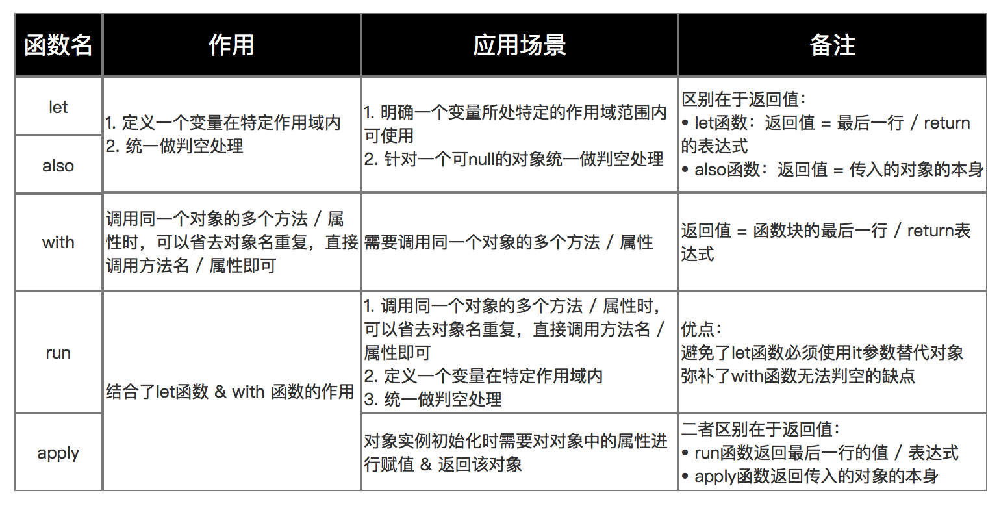

# 函数

## 函数声明

```kotlin
fun 函数名(params: 参数类型): 返回值 {
  // 函数体
}
```

无返回值时，返回类型是 Unit，也可以省略。

简单的函数声明可以省略 {}，例如：

```kotlin
fun sum(n : Int, m : Int) = n + m // 省略了花括号和返回值，因为可以根据类型推断出返回类型
```

函数的最后一个参数如果也是函数，调用时可以将这个参数放到函数外面，例如：

```kotlin
var name.also {
  println(name)
}
```

Kotlin 中的函数参数可以带默认值，如果多个参数都带默认值，调用时可以通过命名参数对特定参数传值。

```kotlin
fun foo(x: Int = 0, y: Int = 100): Int {
 ...
}

// 调用时可以只传一个参数

foo(y = 10)
```

## 匿名函数

匿名函数没有函数名，可以将其赋值给变量，变量的类型为 `(参数类型, 参数类型) -> 返回值类型`，调用的时候加上括号，例如：

```kotlin
// 声明匿名函数
val multi: (Double, Double) -> Double = { x, y ->
    x + y
}

// 使用匿名函数
multi(2.0, 3.0)
val mm = multi
mm(2.0, 3.0)
```

**进阶用法**  

可空函数类型（Nullable Function Type），指函数本身可以为空，注意要把函数声明整体用()包起来。

```kotlin
var callback: (() -> Unit)? = null
callback?.invoke() // 安全调用必须使用 ?.invoke()

```

带接收者的函数类型（Function Type with Receiver），函数内部可以直接用 this 访问接受者

```kotlin
val repeatText: String.(Int) -> String = { times -> this.repeat(times) }
val result = "Hi".repeatText(3) // 输出: HiHiHi
```

挂起函数类型（Suspend Function Type），加 suspend 关键字修饰，表示只能在协程或者另一个挂起函数中调用。

```kotlin
val foo: suspend (String) -> Int = { str -> str.toInt() }

suspend fun fetch() {
  foo("3")
}
```

高阶返回类型（返回函数的函数），返回值也是函数

```kotlin
val foo: (Int) -> (Int) -> Unit = { num -> { n -> println(n) }}
```

## 高阶函数

高阶函数指的是函数的参数或者返回值也是函数，例如：

```java
fun advancedFunc(m: Int, mapper: (Int) -> String): String {
    return mapper(m)
}

advancedFunc(10, { num -> "$num"})
```

高阶函数的最后一个参数如果是匿名函数，在调用时可以把这个匿名函数放在圆括号外面，gradle 的 kotlin DSL 中有很多这种用法。例如上面的调用可以写成：

```kotlin
advancedFunc(10) { num ->
  "$num"
}
```

高阶函数会有一些运行时上的开销，因为函数是一个对象，在函数的实现中，会访问局部变量，因此在内存占用和虚拟调用都会有一定的开销。

## 常见标准高阶函数

**let**  

let是一个作用域函数，在一个作用域内，对对象统一进行操作而不用重复判空。返回值由作用域内最后一行表达式或者return语句决定。

```kotlin
val american: American? = if (System.nanoTime() % 10 > 5) American() else null
val nation = american?.let {
  it.sayHello()
  it.showGift()
  // 返回值
  it.nation // 也可以写成 return it.nation
}
print(nation)
```

**also**  

also的作用和let一样，区别是also返回的是传入作用域的对象。

```kotlin
// also
val chinese = Chinese()
val person = chinese.also {
  it.sayHello()
  // 返回person本身，而不是nation
  it.nation
}
print(person.nation)
```

**with**  

with的使用方法和let类似，返回值是最行一行表达式或者return语句。它有2个参数，第二个参数是匿名函数。使用时用`with(obj){...}`
在作用域内使用时可以省略对象名，直接调用对象的方法或属性。

```kotlin
val age = with(chinese) {
  sayHello()
  print("I come from $nation")
  showGift()
  val age = 20
  // 返回age
  age
}
println("with: age $age")

```

**run**  

run相当于是let和with的结合体，返回值也是**最后一行表达式**或**return语句**，使用时直接用`obj.run{...}`，作用域内可以省略对象名，直接调用方法或属性

```kotlin
val ret = chinese.run {
    sayHello()
    showGift()
    // 返回bye
    "bye"
}
println("run: $ret")
```

**apply**  

apply相当于是also和with的结合体，返回值是**对象本身**。使用时直接用`obj.run{...}`，作用域内可以省略对象名，直接调用方法或属性

```kotlin
val person2 = chinese.apply {
    sayHello()
    showGift()
    sayGoodbye()
    // 返回chinese对象本身
}
println("apply: ${person2.javaClass}") // com.kotlin.classes.Chinese
```



## 内联函数

普通高阶函数调用的时候，会生成一个 Function 实例。内联函数通过 `inline` 关键字修饰，会将调用函数的地方内联成函数的实现。内联函数会引入额外的代码，不过使用得当也能提升性能。

```kotlin
inline fun inlineFun(m: Int, mapper: (Int) -> String) : String {
    return mapper.invoke(m)
}
```

*注意*  

使用内联函数有一个隐患，会暴露私有成员。比如，A 类有一个内联函数访问了 A 的私有属性，B 类的普通函数直接调用 A 的内联函数，在内联的地方，相当于在 B 中直接访问了 A 的私有属性，直接编译是编译不过的。

为了解决这个问题，编译器在编译会做一些处理：

- 访问当前类的私有属性，编译器会生成桥接方法，B 调用 A 时，访问 A 的私有属性实际是调用的私有方法
- 顶层私有成员禁止直接访问，编译期会强制要求把私有的属性公开，加@PublishApi internal

**`reified`保留泛型**

由于内联函数会在调用处被展开，所以内联函数中的泛型参数中有一个特殊的关键字 `reified`，可以在运行时获取泛型的真实类型，其原理是在编译期函数展开时，直接把泛型替换成真实类型。一个典型的用法：

```kotlin
inline fun <reified T> Context.startActivity() {
  val intent = Intent(this, T::class.java)
  startActivity(intent)
}

// 使用
context.startActivity<MainActivity>()
```

**`noinline`禁止内联**

如果不希望传给函数的参数被内联，用 `noinline` 参数修饰函数参数。noinline关键字不能修饰函数，仅能修饰函数参数。

```kotlin
inline fun inlineParams(m: Int, mapper: (Int) -> String, noinline reducer: (Int) -> Int): String {
    return mapper.invoke(reducer.invoke(m))
}
```

**`crossinline`禁止非局部返回**

内联函数的 lambda 参数，用 `crossinline` 可以禁止非局部返回，即禁止直接写return，只允许使用带标签的局部返回（如 return@forEach）。使用crossinline之后，可以防止控制流混乱，同时还保留内联的特性。

```kotlin
inline fun runOnUiThread(crossinline action: () -> Unit) {
    val runnable = Runnable {
        action() // 在另一个局部对象 Runnable 中间接调用了 action
    }
    handler.post(runnable)
}

fun test() {
    runOnUiThread {
        println("执行任务")
        // return         <-- 编译报错！因为 action 被标记为 crossinline，不允许直接结束 test()
        return@runOnUiThread // 合法，仅结束当前 Lambda
    }
}
```

## 扩展函数

扩展函数指在不修改原类的基础上，对类添加新的函数。

```kotlin
// fun 类名.函数名(参数): 返回值 {}
fun ReceiverType.functionName(): ReturnType {
  // this 指向扩展的类
}
```

扩展函数的原理是生成一个静态方法，第一个参数是被扩展类的实例。

扩展函数的特定：

- 不能被重写，因为它是静态的方法
- 成员函数优先级更高，如果类中有同名的函数，调用时会类的成员函数会覆盖扩展函数
- 不能访问私有属性和方法，因为只是对类进行包装，并不会改变可见性

## lambda 表达式

Kotlin 中的 Lambda 表达式本质上是一个可以作为值传递的匿名函数。整体用 {} 包裹，参数不加()，不直接写return。

基本用法：

```kotlin
// 完整写法：{ 参数1: 类型, 参数2: 类型 -> 函数体 }
val sum: (Int, Int) -> Int = { x: Int, y: Int ->
    println("正在计算 $x + $y")
    x + y // 最后一行直接作为返回值
}

// 调用方式
val result = sum(3, 5) // 结果为 8
```

lambda 常见的简化原则：

- 省略参数类型，能推断出类型的参数不显示声明类型
- 单参数用it，只有一个参数，可以用it
- 拖尾 Lambda（Trailing Lambda），函数最后一个参数时lambda，把{}放到()外面
- 省略空括号，函数只有一个lambda 参数，函数本身的()也可以省略

```kotlin
val list = listOf(1, 2, 3, 4)

// 1. 完整原始调用
list.filter({ item: Int -> item > 2 })

// 2. 省略参数类型（类型推导）
list.filter({ item -> item > 2 })

// 3. 单参数使用默认名称 it
list.filter({ it > 2 })

// 4. 拖尾 Lambda（移到括号外）
list.filter() { it > 2 }

// 5. 最终最简写法（省略空括号）
list.filter { it > 2 }

```

常见的特殊写法：

- 无参数的lambda，省略箭头，直接写函数体

```kotlin
val sayHello = { println("Hello Kotlin") }
```

- 未使用的参数，使用`_`代替

```kotlin
map.forEach { _, value -> println(value) }
```

- 带标签的返回，不能直接返回，返回本次直接结果需要用标签

```kotlin
list.forEach {
    if (it == 2) return@forEach // 相当于普通循环中的 continue
    println(it)
}
```

- 解构声明，lambda参数是对象，可以直接解构

```kotlin
val pairs = listOf(1 to "A", 2 to "B")
pairs.forEach { (number, letter) -> println("$number -> $letter") }
```

## 闭包

Kotlin 中的闭包（Closure）指的是一个函数（如 Lambda 表达式、匿名函数或局部函数）能够捕获并访问其外部作用域中声明的变量和参数，即使外部函数已经执行结束，这些被捕获的变量依然可以在闭包内部被读取或修改。

Kotlin 闭包的核心特性是可以修改外部的变量。而 Java 只能修改 final 类型的变量。

```kotlin
fun counter(): () -> Int {
    var count = 0 // 外部可变局部变量
    // 返回的 Lambda 捕获了 count
    return {
        count++   // 直接修改外部变量的值
        count
    }
}

val next = counter()
println(next()) // 输出: 1
println(next()) // 输出: 2（即使 counter() 早已执行完，count 状态依然保留）
```

**实现原理**  

JVM 本身不提供跨栈帧修改变量的能力，Kotlin 通过 Ref 包装实现了这一特性，外部函数和闭包函数持有的实际都是这个变量的 Ref 引用，Ref 对象本身是在堆上，修改属性实际修改的 `ref.element`，从而可以实现跨栈修改。

只读变量(val)：编译器会将变量值作为构造函数的参数传入到 Function 实例中。
可变变量(var)：会通过 Ref 包装，比如 Int 类型用 `Ref$IntRef`，引用类型用 `Ref$ObjectRef`

底层特性：

- 非捕获闭包生成单例，如果一个 lambda 没有引用外部变量，编译器会将其优化成全局单例
- 捕获闭包生成 Function 对象，如果一个 lambda 引用了外部的变量，每次执行到该 lambda 定义的地方，都会在堆上生成一个 Function引用
- 使用 inline 消除闭包对象开销，内联函数会把 lambda 的中的代码块直接拷到调用的地方，从而消除了闭包的内存开销

**潜在风险**  

内存泄漏：闭包会隐式持有外部类的引用，应当避免持有长生命周期的引用

多线程并发：被捕获的 var 变量被 Ref 包装后没有同步锁，要想保证线程安全，需要在用 AtomicInteger 等原子类或者加锁。

*参考：*

[1] Carson.Ho.[巧用Kotlin：内置函数let、also、with、run、apply大大提高你的开发效率！](https://cloud.tencent.com/developer/article/1591238).掘金.2020-02-26
