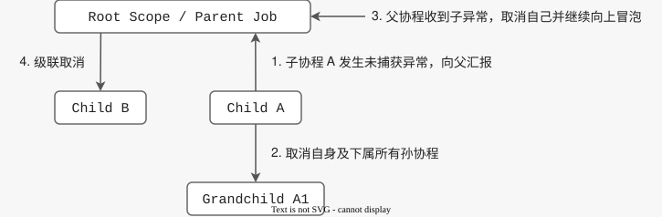

# 异常处理

Kotlin 协程的异常处理遵循沿 `Job` 树向上传播的规则。当子协程抛出普通异常时，普通 `Job` 会取消自身并连坐取消所有兄弟协程，一路冒泡到顶层根协程；而 `SupervisorJob` 则会切断向上传播实现故障隔离。

异常最终由根协程上下文中的 `CoroutineExceptionHandler` 兜底消化，因此它必须安装在顶级作用域或 `SupervisorJob` 的直属子协程上，装在普通子协程或 `async` 上是无效的——因为 `async` 会把异常封装进 `Deferred` 等 `await()` 时才抛出（但在普通父协程下仍会触发连坐取消）。日常开发中，预期内的业务错误用局部 `try-catch` 配合放行 `CancellationException` 处理，而 `CoroutineExceptionHandler` 只作为防止漏网异常导致 App 闪退的全局日志上报安全网。

异常传播机制（普通 Job vs SupervisorJob）、supervisorScope、CoroutineExceptionHandler 的生效边界。

## 异常传播的核心机制

### 捕获异常的正确姿势

协程中的未捕获异常，不是沿着“函数调用栈（Call Stack）”向上抛出，而是沿着结构化并发的“Job 父子层级树”向上传播。用 `try-catch` 代码块包住 `launch` 是捕获不住异常的。

```kotlin
fun loadData() {
    try {
        // ❌ 错误示范：试图在 launch 外面捕获异步异常
        viewModelScope.launch {
            throw RuntimeException("网络请求失败")
        }
    } catch (e: Exception) {
        // 这里永远不会执行！App 依然会直接闪退！
        println("捕获到异常: $e")
    }
}
```

`launch` 是一个非阻塞（Fire-and-Forget）的协程构建器。调用 `launch` 时，它只是把协程体打包提交给调度器排队，然后立刻返回 `Job` 对象并退出 `try-catch` 代码块。等几毫秒后协程体真正执行并抛出异常时，外层的 `try-catch` 早就执行完毕出栈了。

正确做法是将 `try-catch` 写在 `launch` 内部，直接包裹真正可能抛出异常的挂起函数调用：

```kotlin
viewModelScope.launch {
    try {
        api.fetchData() // ✅ 在协程内部调用栈捕获
    } catch (e: Exception) {
        if (e is CancellationException) throw e
        showError(e)
    }
}
```

### 异常的双向传播路径

当协程内部抛出未捕获的普通异常（非 `CancellationException`）时，异常会沿着结构化并发的 Job 树触发“先向下、再向上”的双向级联响应：



### 特殊例外：CancellationException

并非所有异常都会引发上述“全军覆没”的连坐反应。Kotlin 协程特意将 `CancellationException`（及其子类，如 `TimeoutCancellationException`） 划分为“正常取消信号”而非“错误崩溃”。

当对某个子协程调用 `childA.cancel()` 时，Child A 内部会抛出 `CancellationException`。它会取消 Child A 及其下属的 Grandchild A1，但父协程（Parent Job）和兄弟协程（Child B）完全不受任何影响，继续正常运行。

```kotlin
fun main() = runBlocking {
    val childA = launch {
        try {
            delay(2000)
        } finally {
            println("Child A 被正常取消")
        }
    }

    val childB = launch {
        delay(1000)
        println("Child B 不受影响，正常执行完毕！") // 正常打印
    }

    delay(300)
    childA.cancel() // 仅取消 Child A，不会连坐父协程和 Child B
}
```

## 两大构建器的异常表现差异（launch vs async）

### `launch`：立即暴露并向上传播

无论 `launch` 是根协程还是子协程，只要内部抛出未捕获的普通异常，它都会立刻终止自身，并立即沿着父子链向上传播：

- 作为根协程（如直接 `scope.launch { ... }`）：异常立刻交给上下文中的 `CoroutineExceptionHandler`；若未配置，直接触发线程未捕获异常导致 App 崩溃。
- 作为子协程（如在一个 `launch` 内部再 `launch`）：异常立刻向父协程汇报，连带取消父协程及所有兄弟协程。

### `await`：两种表现

#### `async` 作为根协程

当 `async` 直接由顶级作用域（`scope.async`）或 `supervisorScope` 启动时，它充当根协程。此时内部发生异常，框架会静默拦截异常并将其封装在 `Deferred` 对象内部，直到调用方执行 `deferred.await()` 时才会重新抛出：

```kotlin
val scope = CoroutineScope(Job())

// 1. 根 async 内部抛出异常，但此时不会崩溃！异常被存进了 deferred 对象里
val deferred = scope.async {
    throw IllegalStateException("根 async 计算出错")
}

// 2. 如果你永远不调用 deferred.await()，这个异常就彻底被静默吞掉了（CEH 也收不到）
// 3. 只有调用 await() 时，异常才会在调用处被抛出，可用 try-catch 捕获：
scope.launch {
    try {
        deferred.await() // <--- 异常在这里正式抛出！
    } catch (e: Exception) {
        println("成功捕获根 async 异常: ${e.message}")
    }
}
```

#### `async` 作为非根子协程

当 `async` 嵌套在普通 `launch` 或 `coroutineScope { ... }` 内部启动时，它就成了结构化并发树上的一个子协程。此时，即使你把 `try-catch` 包在 `deferred.await()` 外面，甚至根本不调用 `await()`，只要 `async` 内部一抛出异常，它会立刻向上通知父协程，导致整个作用域瞬间崩溃。

```kotlin
// ❌ 经典错误示范：以为 try-catch 包住 await() 就能防住崩溃
viewModelScope.launch {
    val deferred = async {
        delay(200)
        throw RuntimeException("子 async 崩溃") // 1. 异常在此刻发生！
    }

    try {
        deferred.await() // 2. 即使这里加了 try-catch，App 依然会闪退！
    } catch (e: Exception) {
        println("虽然这里能 catch 到一次，但父协程已经被取消并继续把异常往外抛了！")
    }
}
```

原因剖析：在 `async` 内部抛出异常的瞬间，它作为子协程同时做了两件事：

1. 把异常存进 `deferred`（等 `await()` 时抛出）；
2. 同步调用 `parent.childCancelled(cause)` 向父协程汇报异常！由于父协程（`launch`）持有的是普通 `Job`，父协程立刻取消自己并继续把异常向上抛给 `viewModelScope`，最终导致程序崩溃。

**正确做法**  

**写法一：使用 supervisorScope 包裹 async（最推荐，官方标准解法）**  

把外层作用域切换为 supervisorScope { ... }。在 supervisorScope 内部直接启动的 async 充当独立根节点，异常不会向上冒泡连坐父协程，此时在 deferred.await() 外面套 try-catch 就能完美拦截异常：

```kotlin
viewModelScope.launch {
    supervisorScope { // 1. 使用 supervisorScope 切断子协程异常向上传播
        val deferred = async {
            delay(200)
            throw RuntimeException("子 async 崩溃")
        }

        try {
            val result = deferred.await() // 2. 异常在此处被安全抛出并捕获，App 不会崩溃！
            updateUI(result)
        } catch (e: Exception) {
            if (e is CancellationException) throw e // 放行取消异常
            println("成功安全捕获异常，父协程继续正常运行: ${e.message}")
        }
    }
}
```

适用场景：同时并发多个 `async`（如 `async A` 和 `async B`），希望局部失败时互不影响，各自在 `await()` 处降级处理。

**写法二：把 `try-catch` 写进 `async` 代码块内部（源头消化法）**

如果你不关心结构化监督，只是不想让 `async` 内部抛出的异常往外冒，最直接的方式是在 `async { ... }` 内部就地消化异常，并返回一个封装好的结果类型（如 `Result<T>` 或可空类型 `T?`）：

```kotlin
viewModelScope.launch {
    val deferred: Deferred<Result<String>> = async {
        try {
            delay(200)
            throw RuntimeException("网络请求失败")
            Result.success("数据")
        } catch (e: Exception) {
            if (e is CancellationException) throw e // 必须放行取消异常
            Result.failure(e) // 在源头把异常转为普通返回值，不再向父协程冒泡！
        }
    }

    // 外部拿到 Result 安全解包，完全不会引发崩溃
    deferred.await()
        .onSuccess { data -> updateUI(data) }
        .onFailure { err -> println("优雅处理业务失败: ${err.message}") }
}
```

适用场景：单个或少量并发任务，业务上把失败视为正常状态分支（如 Result.failure）。

**写法三：如果不需要并发多个任务，直接改用 `withContext`（极简替代法）**  

很多时候写 `async { ... }.await()` 只是为了切线程拿结果，根本没有并发执行其他兄弟任务。这种情况下不要用 `async`，直接用 `withContext` 即可——它属于当前协程调用栈的一部分，原生支持普通 `try-catch`

```kotlin
viewModelScope.launch {
    try {
        // 直接用 withContext 切线程并同步等待结果，try-catch 100% 生效！
        val result = withContext(Dispatchers.IO) {
            delay(200)
            throw RuntimeException("IO 读取失败")
        }
        updateUI(result)
    } catch (e: Exception) {
        if (e is CancellationException) throw e
        println("完美捕获异常: ${e.message}")
    }
}
```

适用场景：只需切到后台线程执行单个任务并等待结果，无需并行。

## 结构化并发中的异常隔离（Job vs SupervisorJob）

### Job vs SupervisorJob 对比

| 对比维度 | 普通 `Job` / `coroutineScope`（原子连坐模式） | `SupervisorJob` / `supervisorScope`（故障隔离模式） |
| --- | --- | --- |
| 父取消 → 子协程 | 向下级联取消所有子协程 | 向下级联取消所有子协程（保持一致） |
| 子异常 → 父协程 | 向上冒泡，导致父协程自我取消并继续往上传 | 切断上传，父协程保持活跃（Active）不受影响 |
| 子异常 → 兄弟协程 | 连坐取消所有正在运行的兄弟协程 | 完全隔离，兄弟协程继续正常执行 |
| 底层源码差异 | `JobSupport.childCancelled()` 触发 `cancelImpl()` 并返回 `true` | `SupervisorJobImpl` 重写 `childCancelled()`，直接返回 `false` |
| 典型适用场景 | 强原子性操作：多个子任务必须全部成功才有意义，任一失败其余立刻作废（如同时上传主图和缩略图） | UI 独立组件 / 作用域容器：单个模块崩溃不影响其他模块（如 Android `viewModelScope` 底层就是 `SupervisorJob`） |

### SupervisorJob使用场景

**作为顶级 CoroutineScope 的上下文元素**  

创建一个管理生命周期的作用域时，传入 SupervisorJob():

```kotlin
// 1. 创建带监督能力的顶级作用域（类似 viewModelScope 的官方实现）
val uiScope = CoroutineScope(SupervisorJob() + Dispatchers.Main)

// 2. 启动子协程 A（发生未捕获异常）
uiScope.launch {
    delay(200)
    throw RuntimeException("模块 A 加载失败") // 仅模块 A 终止（需配合 CEH 防崩溃）
}

// 3. 启动子协程 B（完全不受模块 A 崩溃的影响！）
uiScope.launch {
    delay(500)
    println("模块 B 依然正常执行完成！") // 正常打印
}
```

**在挂起函数内部使用 `supervisorScope { ... }`**  

如果你已经处于一个挂起函数或普通协程中，想临时开辟一块“互不连坐”的并发区域，直接使用挂起构建器 supervisorScope：

```kotlin
suspend fun fetchHomeSections() = supervisorScope {
    val bannerJob = launch { loadBanners() }   // 就算这里崩溃
    val newsJob = launch { loadHotNews() }     // 这里依然会继续正常运行
}
```

**经典陷阱**  

```kotlin
// ❌ 经典错误写法：把 SupervisorJob() 当参数直接传给 launch！
val scope = CoroutineScope(Job())

scope.launch(SupervisorJob()) { // <--- 陷阱在这里！
    val child1 = launch {
        delay(200)
        throw RuntimeException("Child 1 崩溃")
    }
    val child2 = launch {
        delay(500)
        println("Child 2 还能执行吗？") // ⚠️⚠️⚠️ Child 2 依然会被连坐取消！
    }
}
```

这种写法，lanch启动协程时，child1 和 child2 Context是继承的普通 `Job`，这个普通 `Job` 挂在 `SupervisorJob` 下，因此 child1 抛异常时，child2仍然会被取消。

```text
├── SupervisorJob() 
│   └── launch 自身的普通 Job
│       ├── Child 1
│       └── Child 2
```

两种正确做法：

- 把 SupervisorJob() 放在外层的 CoroutineScope(SupervisorJob()) 中，launch 不传 Job；
- 在 launch 内部使用 supervisorScope { ... } 包裹 child1 和 child2。

## 全局兜底（CoroutineExceptionHandler）

在结构化并发中，当未捕获的异常一路向上冒泡、且没有任何 try-catch 拦截时，最终会由 CoroutineExceptionHandler（简称 CEH）处理异常”。

它是 `CoroutineContext` 的一个可选参数（类似于 Thread.UncaughtExceptionHandler）。一般用来在应用彻底崩溃前进行全局日志记录、上报监控平台或弹出全局错误提示。CoroutineExceptionHandle无法让已经出错的协程恢复执行——一旦进入 CoroutineExceptionHandler，该协程及其子协程必然已经处于终止状态

**使用方法**  

由于异常会一直向父级冒泡，框架规定只有根协程（或独立担当根节点的协程）才会去查询并触发上下文中的 `CoroutineExceptionHandler`。因此正确的用法只有两个：

- 顶层 `CoroutineScope` 的上下文；
- SupervisorJob 直属的子协程（或 supervisorScope 的直属子协程）。

```kotlin
// 定义全局异常处理器
val handler = CoroutineExceptionHandler { context, exception ->
    println("安全网捕获未处理异常: ${exception.message}")
}

// 位置一（最推荐）：安装在顶级 CoroutineScope 的上下文中
val topScope = CoroutineScope(SupervisorJob() + Dispatchers.Main + handler)
topScope.launch {
    throw RuntimeException("网络模块崩溃") // 顺利被 handler 捕获，App 不会崩溃！
}

// 位置二：安装在 SupervisorJob 直属的子协程（或 supervisorScope 的直属子协程）上
val supervisorScope = CoroutineScope(SupervisorJob())
supervisorScope.launch(handler) {
    throw RuntimeException("独立子任务崩溃") // 因 SupervisorJob 拒绝接管，该子协程自成根节点，handler 生效！
}
```

**常见错误**  

普通子协程上：

```kotlin
val scope = CoroutineScope(Job())
scope.launch {
    // ❌ 失效！外层是普通 Job，子协程异常直接向上委托给父协程处理，根本不看自己身上的 handler！
    // 因为顶级 scope 没装 handler，程序依然直接崩溃！
    launch(handler) {
        throw RuntimeException("子协程崩溃")
    }
}
```

async 构建器上：

```kotlin
val scope = CoroutineScope(Job())
// ❌ 失效！根 async 会把异常封装进 Deferred 对象，等调用 deferred.await() 时才抛出，永远不会触发 CEH！
val deferred = scope.async(handler) {
    throw RuntimeException("async 计算崩溃")
}
```

遇到 CancellationException：

```kotlin
val scope = CoroutineScope(Job() + handler)
val job = scope.launch {
    delay(1000)
}
// ❌ 不会触发 handler！CancellationException 被视为正常取消，永远不会传给 CEH
job.cancel()
```

## 高阶异常聚合与底层实现原理

当父协程下面同时运行着多个子协程，如果其中一个子协程崩溃引发连坐取消，而另一个兄弟协程在执行 finally 清理时也抛出了新异常，异常聚合机制（Exceptions Aggregation）完美保留了所有错误现场，而不会像传统回调那样丢失第二个异常。

当多个子协程先后抛出未捕获异常时，框架严格遵循“先到者为主，后来者抑制追加（Suppressed）”的原则：

1. 主异常（Root Cause）：第一个抛出异常（非 `CancellationException`）的子协程，其异常会被父协程锁定为主异常。
2. 抑制异常（Suppressed Exceptions）：在父协程取消其他兄弟协程的过程中，如果其他兄弟协程在 `finally` 块中也抛出了新的非取消异常，这些后续异常不会被丢弃，而是通过 Java/Kotlin 原生的 `Throwable.addSuppressed(otherException)` 方法，全部挂载到主异常的 `suppressed` 数组中！
3. 最终交付：直到所有子协程都彻底取消并清理完毕后，父协程才会把携带了完整 `suppressed` 列表的主异常交给 `CoroutineExceptionHandler` 或向外抛出。

```kotlin
import kotlinx.coroutines.*
import java.io.IOException

fun main() = runBlocking {
    val handler = CoroutineExceptionHandler { _, exception ->
        // 1. 拿到主异常（最先发生的 IOException）
        println("主异常: $exception")
        // 2. 通过 suppressed 数组找回所有兄弟协程在清理时抛出的后续异常！
        println("被抑制的伴随异常: ${exception.suppressed.contentToString()}")
    }

    val scope = CoroutineScope(Job() + handler)
    scope.launch {
        // 子协程 1：在收到取消信号后的 finally 清理阶段，又抛出了新的 ArithmeticException
        launch {
            try {
                delay(Long.MAX_VALUE) // 无限挂起等待被连坐取消
            } finally {
                throw ArithmeticException("子协程 1 清理时发生算术异常") // 第二个异常！
            }
        }

        // 子协程 2：最先崩溃，抛出 IOException（成为主异常）
        launch {
            delay(100)
            throw IOException("子协程 2 发生网络 I/O 异常") // 第一个异常！
        }
    }.join()
}
```

**实现原理**  

在 kotlinx.coroutines 源码的 JobSupport.kt 中，异常聚合与协调全靠 Finishing 状态对象在无锁状态机上完成：

1. **锁定 rootCause：**
   当子协程 2 最先调用 `parent.childCancelled(IOException)` 时，父协程通过 CAS 将 `_state` 切换为 `Finishing(list, isCancelling = true, rootCause = IOException)`，同时遍历 `NodeList` 向子协程 1 发送取消信号。
2. **等待所有子协程彻底终结（Completing / Cancelling 屏障）：**
   父协程不会立刻抛出 `IOException` 结束自己，而是必须挂起等待所有子协程（包括正在跑 `finally` 的子协程 1）全部进入最终态。
3. **收集伴随异常（addExceptionLocked）：**
   子协程 1 在 `finally` 中抛出 `ArithmeticException` 并向上汇报给父协程时，父协程发现 `_state` 已经处于 `Finishing` 且已有 `rootCause`，于是调用 `finishing.addExceptionLocked(ArithmeticException)` 将其暂存进内部异常列表。
4. **最终状态收敛与聚合（finalizeFinishingState）：**
   当最后一个活跃子协程也彻底结束后，父协程进入 `finalizeFinishingState()`，遍历暂存的异常列表（自动过滤掉无意义的 `CancellationException` 和重复引用），逐一调用 `rootCause.addSuppressed(e)` 组装成最终异常对象，随后触发 `handleJobException(rootCause)` 交付给 `CoroutineExceptionHandler`。

**异常栈追踪恢复（Stacktrace Recovery）**  

在异步编程中，异常往往在后台线程池的底层回调中抛出，如果直接打印堆栈，往往只能看到线程池调度代码，看不到“最初是在哪个业务页面、哪一行 launch 启动的协程”。

- Kotlin 协程的自动修复：在 Debug 模式（JVM 默认开启）下，当异常沿着状态机（`BaseContinuationImpl`）和父子 `Job` 树向上传播时，框架会自动把挂起点的调用栈帧（`CoroutineStackFrame`）拼接到原始异常的 `StackTrace` 尾部，让你在日志里一眼看到完整的跨线程业务调用路径。

## 最佳实践

在客户端大型项目中，异常治理不能靠“到处乱加 try-catch”或“全指望 CoroutineExceptionHandler 兜底”，而是要建立分层分级的异常防御体系，同时规避几个最常见的工程陷阱。

**工程级异常分层治理策略（三层防线）**  

| 防线层级 | 捕获工具 | 负责处理的异常类型 | 典型动作 |
| --- | --- | --- | --- |
| 第一层：业务调用点 | 局部 `try-catch` 或 `suspendRunCatching` | 预期内的可恢复业务异常（网络超时、HTTP 401/500、JSON 解析异常） | 更新页面状态为 `ErrorState`、弹出 Toast 提示、展示重试按钮 |
| 第二层：并发编排层 | `supervisorScope` + 单个 `await()` 局部捕获 | 多模块并发时的非核心模块异常（首页推荐卡片、广告 Banner 失败） | 局部降级为空列表或隐藏卡片，保障主流程照常渲染 |
| 第三层：全局兜底网 | 顶级 `CoroutineExceptionHandler` | 未预料的代码 Bug（空指针 NPE、数组越界、数据格式契约彻底破坏） | 记录完整堆栈、上报 Crash 监控平台（Sentry / Firebase），避免直接闪退 |

**最佳实践**  

1. **避免在挂起函数里直接用标准库 `runCatching`**
   runCatching 内部捕获的是顶级 `Throwable`，会吃掉 `CancellationException`，导致协程不知道自己已经取消，继续往下走刷新 UI 逻辑，直接引发视图空指针崩溃。正确的做法是封装一个 `suspendRunCatching`，放行 `CancellationException`。

   ```kotln
    // ✅ 团队规范：挂起函数中一律使用 suspendRunCatching 替代标准库 runCatching
    suspend inline fun <T> suspendRunCatching(crossinline block: suspend () -> T): Result<T> {
        return try {
            Result.success(block())
        } catch (c: CancellationException) {
            throw c // 核心：放行取消异常，绝不破坏结构化并发！
        } catch (e: Throwable) {
            Result.failure(e)
        }
    }
   ```

2. **`supervisorScope` 内部并发多个 `async`，避免把 `try-catch` 写在最外层**
   `try-catch` 写在 `supervisorScope` 外面，一旦其中一个 `await()` 抛出异常，整个 `supervisorScope` 块会直接中断退出，连带取消掉正在运行的其他任务。正确做法是给每个 `await` 单独捕获异常。

   ```kotlin
   viewModelScope.launch {
        // ❌ 错误位置：try-catch 写在 supervisorScope 外面，一旦 userTask.await() 抛出异常，
        // 整个 supervisorScope 块会直接中断退出，连带取消掉正在运行的 bannerTask！
    
        // ✅ 正确姿势：supervisorScope 内部，为每一个可能降级的 deferred.await() 单独包裹！
        supervisorScope {
            val bannerDeferred = async { api.getBanners() }
            val feedDeferred = async { api.getFeeds() }

            val banners = suspendRunCatching { bannerDeferred.await() }.getOrDefault(emptyList())
            val feeds = suspendRunCatching { feedDeferred.await() }.getOrDefault(emptyList())

            renderHome(banners, feeds) // 即使其中一个接口挂了，另一个数据依然正常上屏！
        }
    }
   ```

3. Flow 收集链中的异常处理规范（catch 操作符）
   当挂起函数演进为异步数据流 Flow 时，严禁在 flow { emit(...) } 内部写 try-catch 包裹 emit（这会违反异常透明性原则，甚至误吞下游 collect 抛出的异常）。标准做法是使用声明式的 .catch { ... } 操作符：

   ```kotlin
    repository.observeUserUpdates()
        .onEach { user -> updateUI(user) }
        // ✅ 只捕获上游（observeUserUpdates 与 onEach）抛出的普通异常，且自动放行 CancellationException！
        .catch { throwable -> 
            showErrorBanner(throwable.message) 
        }
        .launchIn(viewModelScope)
   ```

---

**参考**  

[1] Manuel Vivo. [Coroutines & Patterns for work that shouldn’t be cancelled](https://manuelvivo.dev/coroutines-cancellation-exceptions-4). Manuel Vivo .dev, 2020-04-07  
[2] Kotlin. [Cancellation and timeouts](https://kotlinlang.org/docs/coroutines-cancellation.html). Accessed 2026-11-26.  
[3] Open AIDoc. [协程异常处理](https://openaidoc.org/kotlin/exception-handling). Accessed 2026-11-26.  
